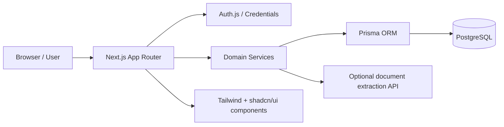

# CreditFlow CRM

CreditFlow CRM is a public-facing portfolio project inspired by the internal systems used by a credit correspondent to manage clients, proposals, pricing, commissions and performance. The goal is to simulate a real product experience: clear role-based access, operational workflow, and a dependable interface designed for a credit operation team without exposing any sensitive production data.

This application focuses on the everyday work of a credit correspondent: onboarding customers, moving loan proposals through approval stages, validating affordability with a pricing simulator, paying partner commissions, and tracking monthly performance with role-aware insight.

## Screenshots / GIF

The project is structured to be product-oriented from the first screen onwards. In a production-ready version, the following views would be captured as screenshots or a short walkthrough GIF:

- Dashboard overview with production, ticket, conversion and partner ranking
- Client registry with masked CPF rules and document upload workflow
- Proposal board in kanban format for the status pipeline
- Credit simulator with margin comparison and pricing table
- Admin panel for pricing rules and partner-product commission settings

## Features

- Role-aware access: ADMIN, OPERADOR and PARCEIRO
- Client management with valid CPF checks and masked display for non-admin users
- Proposal pipeline covering Consulta, Digitação, Análise, Aprovada, Recusada and Paga
- Status history with actor and timestamp for auditability
- Loan simulator based on the Price method using configurable monthly rates and payment term rules
- Partner and product commission logic calculated when a proposal reaches the paid status
- Monthly dashboard with production, average ticket, conversion, partner ranking and period filters
- Optional document extraction integration with a mock fallback when no external service is configured

## Architecture



## Technical decisions

### Prisma
Prisma keeps the data model explicit, versioned and easy to evolve. Migrations are stored in the repository and the schema is the source of truth for the database, which makes the project easier to test, document and evolve as new features are added.

### Auth.js with role restrictions
The product uses credentials-based authentication and restricts access from server-side checks. This keeps authorization close to the business layer and prevents accidental exposure of data by component-only conditions.

### Server Actions and service layer
Business rules live in a service layer rather than inside route handlers or UI components. This separation makes validation and logic easier to test and reduces duplication across forms and screens.

### Tailwind + shadcn/ui
The interface relies on a clear design system with reusable UI primitives, while preserving the ability to adapt quickly to product needs without writing large amounts of custom CSS.

## Run in 3 commands

1. Copy the environment file:
   ```bash
   cp .env.example .env
   ```

2. Start PostgreSQL locally:
   ```bash
   docker compose up -d db
   ```

3. Install dependencies, migrate the database, seed the synthetic data and start the app:
   ```bash
   npm install && npm run db:generate && npm run db:deploy && npm run db:seed && npm run dev
   ```

Then open http://localhost:3000.

## Test users by role

The seed creates synthetic users for local development. Use the password defined in `.env` as `SEED_USER_PASSWORD`.

- ADMIN: admin@creditflow.local
- OPERADOR: operator@creditflow.local
- PARCEIRO: partner@creditflow.local

## Testing

Run the project checks locally with the following commands:

```bash
npm run lint
npm run typecheck
npm test
npx playwright install --with-deps chromium
npm run test:e2e
```

The GitHub Actions workflow runs linting, type-checking, unit tests and end-to-end tests on every push and pull request.

## Limitations and next steps

- The project is intentionally product-oriented and does not connect to a real credit bureau or external banking core.
- The document extraction feature is optional and gracefully falls back to mock data when no endpoint is configured.
- Reporting is currently centered on monthly operational KPIs and could expand to deeper cohort, collection and risk analysis over time.
- The next step would be to mature the admin experience with multi-tenant configuration, export workflows, notifications and richer operational audit views.

## License

This project is distributed under the MIT license. See the LICENSE file for details.
